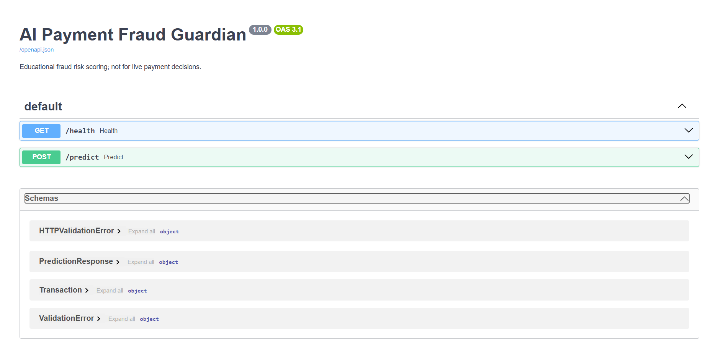
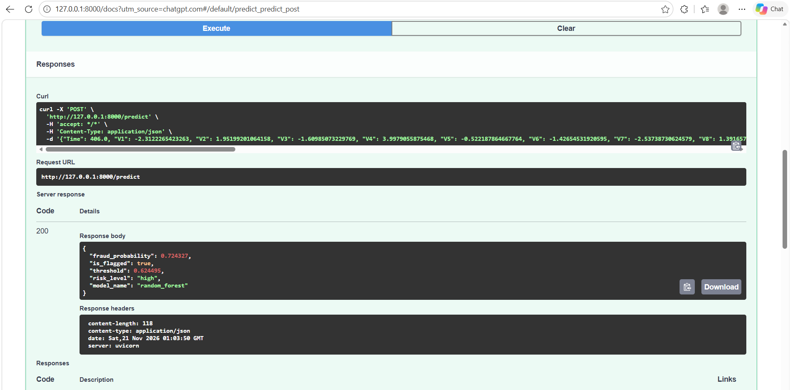
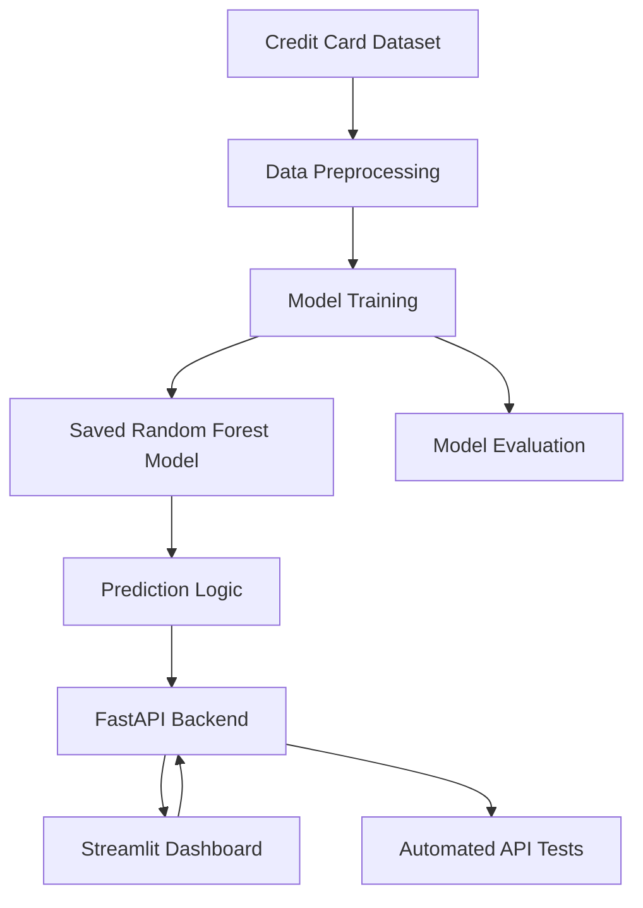

# AI Payment Fraud Guardian

An educational, end-to-end credit-card fraud classifier using a real anonymised dataset, scikit-learn, FastAPI, Streamlit and pytest.

## Architecture

`data/creditcard.csv` → `src/preprocess.py` → `src/train.py` → `models/fraud_model.joblib` → `src/predict.py` → `api/main.py` ← `dashboard/app.py`

`src/evaluate.py` evaluates on a held-out test split; `tests/` contains automated tests.

## Setup (Python 3.11 recommended)

From the repository root:

```bash
python -m venv .venv
# Windows PowerShell:
.venv\Scripts\python -m pip install -r requirements.txt
# macOS/Linux:
# .venv/bin/python -m pip install -r requirements.txt
```

Ensure `data/creditcard.csv` exists. If absent, download it from the Kaggle source documented in `data/README.md`.

## Train and evaluate

```bash
python -m src.train
python -m src.evaluate
python -m pytest -q
```

Training compares a class-weighted Logistic Regression baseline with Random Forest. Model selection uses **validation PR-AUC**; a threshold is selected using **validation F1**. The held-out test split is not used for model selection. Preprocessing (median imputation and baseline scaling) is fitted only on the training data as part of the sklearn pipeline.

The model file is generated by training and saved as `models/fraud_model.joblib`; `models/metrics.json` stores validation and test results. The supplied model artifact was trained in the generation environment and should be regenerated locally to verify reproducibility.

## Start backend and dashboard (two terminals)

```bash
python -m uvicorn api.main:app --reload
python -m streamlit run dashboard/app.py
```

Open http://127.0.0.1:8501 and upload a CSV containing `Time`, `V1`–`V28`, `Amount` (optionally `Class`). Select a row to score. API docs: http://127.0.0.1:8000/docs.

### API example

`POST /predict` with JSON containing exactly 30 numeric feature fields. Example request can be generated from a row of `creditcard.csv` without `Class`. Returns probability, threshold, flag and risk category. Invalid inputs return HTTP 422; missing model returns 503.

## Limitations and ethical use

- This is a **research/portfolio demo**, not a production fraud control or a real PayPal integration.
- The V-features are anonymised PCA components; users cannot enter ordinary card details and receive a meaningful score.
- Data is historical and severely imbalanced. A stratified random split does not measure performance on future transactions; a time-ordered evaluation would be a stronger next step.
- Probability is a model estimate, **not guaranteed calibrated**; the risk category is a threshold-based review flag, not proof of fraud.
- False positives may inconvenience legitimate customers; false negatives may miss fraud. Human review and monitoring would be necessary in a real system.
- Never load a `.joblib` model from an untrusted source.

## Suggested learning order

Read `data/README.md`, then `src/preprocess.py`, `src/train.py`, `src/evaluate.py`, `src/predict.py`, `api/schemas.py`, `api/main.py`, `dashboard/app.py` and finally `tests/`.
## Dataset

This project uses the **Credit Card Fraud Detection** dataset from Kaggle, associated with the Machine Learning Group at Université Libre de Bruxelles (ULB) and Worldline.

- **Total transactions:** 284,807
- **Fraudulent transactions:** 492
- **Features:** Time, V1–V28, Amount and Class
- **Source:** https://www.kaggle.com/datasets/mlg-ulb/creditcardfraud

### Download instructions

The dataset is not included in this GitHub repository because the CSV file exceeds GitHub's normal file-size limit.

To run the project:

1. Download the dataset from the Kaggle link above.
2. Extract the downloaded ZIP.
3. Copy `creditcard.csv` into the project's `data/` folder.
4. Run the training instructions in this README.

## Application Screenshots

### 1. Streamlit Fraud Prediction Dashboard


### 2. FastAPI Documentation


### 3. Successful Fraud Detection API Response


### 4. Automated Testing


## Model Evaluation Results

The selected Random Forest model was evaluated on a
held-out test dataset.

### Performance Metrics

| Metric | Test Result |
|---|---:|
| PR-AUC | 0.7711 |
| ROC-AUC | 0.9609 |
| Precision | 0.8816 |
| Recall | 0.7053 |
| F1-score | 0.7836 |
| Decision Threshold | 0.6245 |

### Confusion Matrix

| Actual / Predicted | Legitimate | Fraud |
|---|---:|---:|
| Legitimate | 56,642 | 9 |
| Fraud | 28 | 67 |

### Key Findings

- Correctly identified 67 fraudulent transactions.
- Missed 28 fraudulent transactions.
- Incorrectly flagged 9 legitimate transactions.
- Achieved 88.16% precision and 70.53% recall.

### Limitations

This project is an educational demonstration
using a historical credit card dataset.

The reported results do not establish performance
on live payment transactions.


## System Architecture


