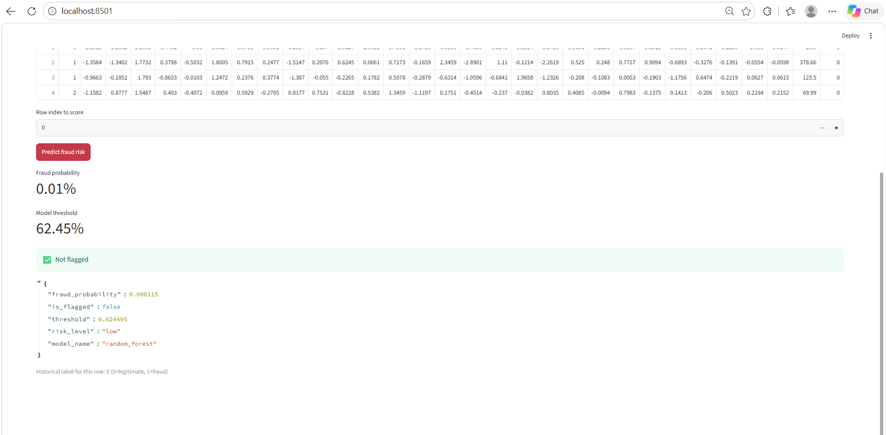
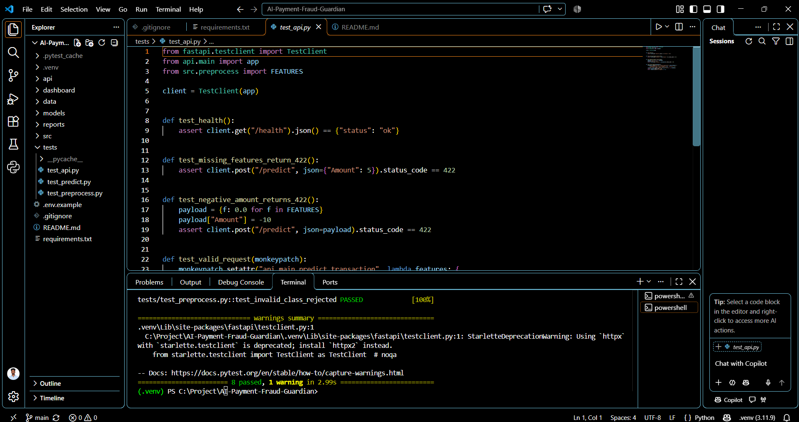
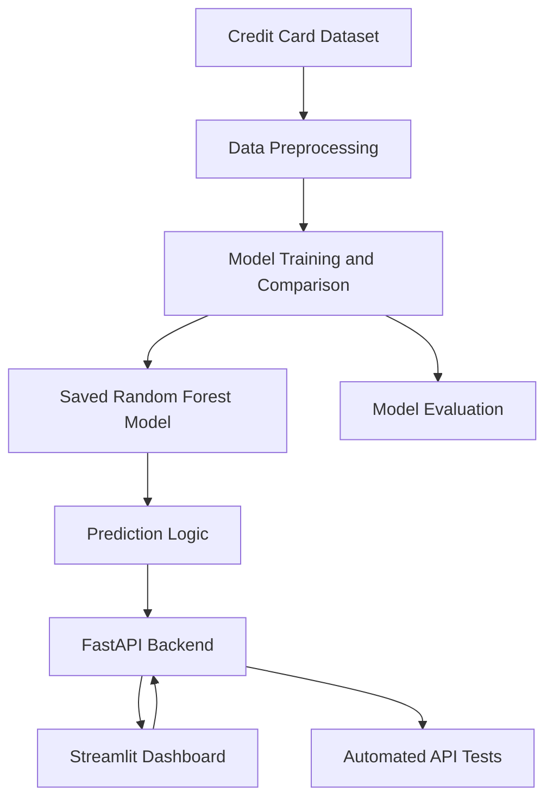

# 🛡️ AI Payment Fraud Guardian

### End-to-End Machine Learning Fraud Detection System

An educational, end-to-end machine learning application that identifies potentially fraudulent credit card transactions using **Random Forest, Scikit-learn, FastAPI, Streamlit and Pytest**.

The project demonstrates a complete machine learning workflow, including data preprocessing, model comparison, threshold optimisation, REST API development, dashboard integration, model evaluation and automated testing.

**Project type:** Machine Learning / AI Engineering Portfolio Project  
**Language:** Python 3.11  
**Status:** Completed educational prototype  
**Purpose:** Demonstration and research only — not suitable for live payment decisions.

---

## 🚀 Key Project Highlights

- Developed an end-to-end fraud classification pipeline using Scikit-learn.
- Compared Logistic Regression and Random Forest using validation PR-AUC.
- Selected Random Forest with a **validation PR-AUC of 0.8646**.
- Achieved a **test PR-AUC of 0.7711** and **test F1-score of 0.7836**.
- Implemented a FastAPI backend with prediction and health-check endpoints.
- Built an interactive Streamlit dashboard for CSV-based transaction analysis.
- Implemented automated tests covering API validation, prediction logic and preprocessing.
- Successfully executed **8 automated tests using Pytest**.

## 📸 Application Screenshots

### 1. Streamlit Fraud Prediction Dashboard

The Streamlit dashboard allows users to upload transaction CSV files, select individual transactions and view model-generated fraud risk predictions.



### 2. FastAPI Documentation

The FastAPI backend exposes REST endpoints for health checking and transaction risk prediction.


### 3. Fraud Detection API Response

Example of a successful API prediction for a transaction flagged as high risk.

- HTTP status: `200 OK`
- Fraud probability: `0.724327` (72.43%)
- Classification threshold: `0.624495` (62.45%)
- Fraud flag: `true`
- Risk level: `high`
- Model: `random_forest`


### 4. Automated Testing

The project uses Pytest to validate the backend, prediction logic and data preprocessing.

**Verified test result: 8 passed, 1 warning**



---

## 📊 Model Performance

The selected Random Forest classifier was evaluated on a separate held-out test dataset.

### Evaluation Metrics

| Metric | Test Result |
|---|---:|
| PR-AUC | 0.7711 |
| ROC-AUC | 0.9609 |
| Precision | 0.8816 |
| Recall | 0.7053 |
| F1-score | 0.7836 |
| Classification Threshold | 0.6245 |

### Confusion Matrix

| Actual / Predicted | Legitimate | Fraud |
|---|---:|---:|
| Legitimate | 56,642 | 9 |
| Fraud | 28 | 67 |

### Key Findings

- Correctly identified **67 fraudulent transactions**.
- Missed **28 fraudulent transactions**.
- Incorrectly flagged **9 legitimate transactions**.
- Correctly identified **56,642 legitimate transactions**.
- Achieved **88.16% precision** and **70.53% recall** for the fraud class.

These results demonstrate the model's performance on the historical held-out test set. They do not establish its performance on live transactions.

---

## 🧠 Model Selection — Why Random Forest?

Two machine learning algorithms were compared during model development:

1. Logistic Regression — class-weighted baseline
2. Random Forest Classifier

### Validation Performance

| Model | Validation PR-AUC |
|---|---:|
| Logistic Regression | 0.8139 |
| **Random Forest** | **0.8646** |

### Why Random Forest Was Selected

Random Forest achieved the higher validation PR-AUC in this experiment.

**PR-AUC (Precision-Recall Area Under the Curve)** was used for model comparison because fraudulent transactions represent a very small proportion of the dataset.

Random Forest was selected because:

- It achieved better validation PR-AUC than the Logistic Regression baseline.
- It can model nonlinear relationships between transaction features.
- It can capture interactions between features without requiring them to be specified manually.
- Its performance made it the preferred candidate for the final educational system.

This result is specific to the evaluated dataset and training configuration. It does not imply that Random Forest is universally superior.

### Classification Threshold Optimisation

Instead of using the default classification threshold of `0.5`, the project selects a threshold using validation F1-score.

**Selected threshold: 0.624495 (62.45%)**

Transactions with predicted fraud probabilities meeting the decision threshold are flagged for review.

The held-out test dataset was not used for model selection or threshold optimisation.

---

## 🏗️ System Architecture

The application separates model development, prediction logic, the backend API and the user interface.



### Core Components

| Component | Responsibility |
|---|---|
| `src/preprocess.py` | Data preparation and train/test splitting |
| `src/train.py` | Model training, comparison and selection |
| `src/evaluate.py` | Held-out test evaluation |
| `src/predict.py` | Transaction prediction logic |
| `api/schemas.py` | Request and response validation |
| `api/main.py` | FastAPI REST endpoints |
| `dashboard/app.py` | Streamlit interface |
| `tests/` | Automated tests |

The preprocessing pipeline uses median imputation and scaling where appropriate. Preprocessing is fitted using training data to reduce data leakage.

---

## 🗂️ Dataset

This project uses the **Credit Card Fraud Detection** dataset, associated with the Machine Learning Group at Université Libre de Bruxelles (ULB) and Worldline.

**Dataset source:** [Kaggle — Credit Card Fraud Detection](https://www.kaggle.com/datasets/mlg-ulb/creditcardfraud)

| Property | Value |
|---|---|
| Total transactions | 284,807 |
| Fraudulent transactions | 492 |
| Legitimate transactions | 284,315 |
| Features | Time, V1–V28, Amount |
| Target variable | Class |
| Classification type | Binary |
| Class 0 | Legitimate |
| Class 1 | Fraudulent |

The dataset is severely imbalanced, with fraudulent transactions representing approximately 0.173% of all records.

### Download Instructions

The dataset is not included in this GitHub repository because the CSV file exceeds GitHub's normal file-size limit.

1. Download the dataset from the Kaggle link above.
2. Extract the downloaded ZIP archive.
3. Copy `creditcard.csv` into the `data/` directory.
4. Follow the installation and training instructions below.

Additional dataset information is available in `data/README.md`.

---

## 🛠️ Technologies Used

| Category | Technologies |
|---|---|
| Programming | Python 3.11 |
| Machine Learning | Scikit-learn |
| Data Processing | Pandas, NumPy |
| Model Persistence | Joblib |
| Backend API | FastAPI, Uvicorn |
| Frontend Dashboard | Streamlit |
| Testing | Pytest |
| Model Evaluation | PR-AUC, ROC-AUC, Precision, Recall, F1-score |

---

## ⚙️ Installation and Setup

### Step 1 — Clone the Repository

```bash
git clone https://github.com/justlivingwith007-tech/AI-Payment-Fraud-Guardian.git
cd AI-Payment-Fraud-Guardian
```

### Step 2 — Create a Virtual Environment

Python 3.11 is recommended.

```powershell
python -m venv .venv
```

### Step 3 — Install Dependencies

**Windows PowerShell**

```powershell
.\.venv\Scripts\python.exe -m pip install -r requirements.txt
```

**macOS / Linux**

```bash
.venv/bin/python -m pip install -r requirements.txt
```

### Step 4 — Prepare the Dataset

Ensure the following file exists:

```text
data/creditcard.csv
```

### Step 5 — Train the Model

**Windows PowerShell**

```powershell
.\.venv\Scripts\python.exe -m src.train
```

The training process compares Logistic Regression and Random Forest and saves the selected model.

The trained model is saved to:

```text
models/fraud_model.joblib
```

### Step 6 — Evaluate the Model

```powershell
.\.venv\Scripts\python.exe -m src.evaluate
```

The evaluation script reports PR-AUC, ROC-AUC, precision, recall, F1-score, the confusion matrix and the selected threshold.

Validation and test metrics are stored in `models/metrics.json`.

---

## 🌐 Running the Application

The system uses two separate processes: the FastAPI backend and the Streamlit dashboard.

Both commands below assume that you are running them from the repository root.

### Terminal 1 — Start FastAPI

```powershell
.\.venv\Scripts\python.exe -m uvicorn api.main:app --reload
```

API documentation:

http://127.0.0.1:8000/docs

### Terminal 2 — Start Streamlit

```powershell
.\.venv\Scripts\python.exe -m streamlit run dashboard/app.py
```

Dashboard:

http://localhost:8501

### Using the Dashboard

1. Open the Streamlit dashboard.
2. Upload a transaction CSV file.
3. Select a transaction using its row index.
4. Click **Predict fraud risk**.
5. Review the fraud probability, model threshold, risk flag and API response.

The dashboard accepts CSV data containing `Time`, `V1` through `V28`, and `Amount`. The historical `Class` label is optional and is not passed to the API as a prediction feature.

---

## 🔌 REST API

The FastAPI backend exposes two primary endpoints.

| Method | Endpoint | Purpose |
|---|---|---|
| GET | `/health` | API health check |
| POST | `/predict` | Fraud risk prediction |

### Example API Response

```json
{
  "fraud_probability": 0.724327,
  "is_flagged": true,
  "threshold": 0.624495,
  "risk_level": "high",
  "model_name": "random_forest"
}
```

The prediction endpoint requires the 30 numeric transaction features: `Time`, `V1`–`V28`, and `Amount`.

- Valid prediction requests return a model-generated response.
- Invalid requests return HTTP `422`.
- Missing model artifacts return HTTP `503`.

The response is intended for educational risk scoring, not automated approval or blocking of payments.

---

## 🧪 Automated Testing

The project includes automated tests for:

- API health endpoint.
- Missing prediction features.
- Invalid negative transaction amounts.
- Valid prediction requests.
- Prediction and risk-flagging logic.
- Data preprocessing and split integrity.

### Run Tests

Open a separate terminal in the project root.

```powershell
.\.venv\Scripts\python.exe -m pytest -v
```

**Verified result:**

```text
8 passed, 1 warning in 2.99s
```

The observed warning relates to the `httpx`/Starlette testing interface and does not indicate a failed test.

---

## ⚠️ Limitations and Ethical Considerations

This project is designed for education, experimentation and portfolio demonstration.

- **Not production-ready:** The system must not be used to approve, reject or block real financial transactions.
- **Historical data:** A stratified random split does not establish future performance. Time-ordered evaluation would provide a stronger assessment.
- **Class imbalance:** Fraudulent transactions are rare, making precision and recall important.
- **Anonymised features:** The V1–V28 variables are anonymised PCA components. Ordinary card information cannot be entered to produce a meaningful prediction.
- **Probability calibration:** Model probabilities are not guaranteed to be calibrated.
- **False positives and false negatives:** Some legitimate transactions may be flagged, and some fraudulent transactions may be missed.
- **Human oversight:** Real financial systems would require monitoring, governance, appropriate review processes and additional safeguards.
- **Model security:** Never load Joblib model files from untrusted sources.

This project does not integrate with PayPal or any live payment processing service.

---

## 📚 Suggested Code Reading Order

For readers interested in understanding the implementation:

1. `data/README.md` — Dataset details.
2. `src/preprocess.py` — Data preparation.
3. `src/train.py` — Training and model selection.
4. `src/evaluate.py` — Performance evaluation.
5. `src/predict.py` — Prediction logic.
6. `api/schemas.py` — Input and output validation.
7. `api/main.py` — FastAPI backend.
8. `dashboard/app.py` — Streamlit interface.
9. `tests/` — Automated testing.

---

## 🔮 Future Improvements

Planned areas for further development include:

- Docker containerisation.
- GitHub Actions continuous integration.
- Time-ordered model evaluation.
- Model probability calibration.
- Additional feature analysis and model explainability.
- Deployment to a suitable cloud environment.
- More robust monitoring and error handling.

These are future enhancements, not currently implemented features.

---

## 👨‍💻 About the Developer

**Aswin Balasubramanian**

MSc Artificial Intelligence student at the **University of Leicester, United Kingdom**.

Interested in AI engineering, machine learning systems and building practical applications that connect predictive models with software engineering.

Currently seeking **2027 UK AI/ML internships and industrial placements**.

**[GitHub](https://github.com/justlivingwith007-tech)** | **[LinkedIn](https://www.linkedin.com/in/aswin-balasubramanian-10b1aa321/)**

---

*Built as an educational project to strengthen practical machine learning, backend development and software testing skills.*